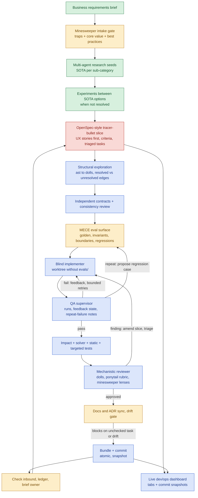

# /sf: owner's desired flow vs current state, and an integration plan

Status: audit and proposal. Nothing in this plan is implemented. Date 2026-10-19, branch `agent-graph`, repo head `d0fd4c0`.
Sources: `/home/linuxuser/sf-workflow-owner-request-verbatim.md` (authoritative flow) and `/home/linuxuser/sf-verification-followup.md` (verification requirements, reconciled in section 6). The owner flow is kept whole; the shorter pipeline in the follow-up is placed inside it, not substituted for it.

## How this was produced, and its limits
- I read both documents verbatim, then inspected settings, hooks, skills, plugins and the repo myself. I delegated three independent read-only audits (workflow stages, dashboards and telemetry, verification and structure tooling). Their line citations are quoted below; I re-checked these myself: no agent definitions exist, the minesweeper lines in `sf`, the fail-open code in `factory/governance.py:222-236`, and zero mentions of ponytail or mermaid in the sf, review, orchestration, prd-writer, ops-dashboard-design and minesweeper skills.
- The owner asked to "check with the claude vps session and use my prompt verbatim". I am that session and used the verbatim text as the spec. I did not run it as a fresh prompt against a clean model; that would be a useful second opinion and is listed as an open item.
- Everything marked UNVERIFIED below was reported by an auditor or inferred and not run by me.

## 1. Owner flow mapped to current implementation

Legend: ENFORCED = a hook, script or agent makes it happen. PROSE = written advice in a skill or doc. NONE = nothing found.

| # | Owner step | What exists today (evidence) | Mechanism | Missing |
|---|---|---|---|---|
| 1 | Biz requirements intake | `spec-recomposition`, `biz-decomposer`, `prd-writer` skills in `~/.claude/skills`. `sf/SKILL.md:47`: build the ledger line by line from the source. | PROSE (skills have scripts, but sf does not name `spec-recomposition` or `biz-decomposer`) | A ledger generator and a check that intake ran. |
| 2 | Minesweeping for core business value and best practices | `sf/SKILL.md:116` (stages 1-2 run as the minesweeper loop), `:188` (hunting list at review), `:202` (delta sweep at stage 9), `:240` (stage 12). `~/.claude/skills/minesweeper` has engine, 26 lenses, tests. | Skill has code; the link from sf is PROSE; no hook invokes it | Owner wants it to extract core business value and best practices, not only traps: the skill is a trap sweep. Needs a value-extraction mode. Lens coverage of networking, cryptography, performance and ethics is UNVERIFIED. |
| 3 | Multi-agent research seeds on SOTA | `sf:100` names deep-research and grounded-research. `biz-decomposer` produces ranked research seeds. | PROSE | No fan-out definition. The research role exists only as a spec (`docs/plans/2026-09-24-seven-core-agents.md`, "nothing built"). |
| 4 | Experiments between SOTA options | `sf:125-154`, `experiment-designer` skill. | PROSE | `experiment-designer` is not named in sf stage 2. No results store. |
| 5 | OpenSpec-inspired tracer-bullet PRDs starting with UX stories, triaged | `sf:159` MECE tracer-bullet spec. `prd-writer` has `scripts/check_scope.py` (overlap and dependency cycles). | One script; rest PROSE | No UX-story step, no OpenSpec artifact, no priority triage anywhere (auditor grep of sf, prd-writer, spec-recomposition, biz-decomposer, axiomatic-spec, eval-designer and docs found none). |
| 6a | MECE eval surface with golden gates, invariants, boundaries, regressions | `sf:169`, `eval-designer`; repo has `evals/agents` (1,302 cases, golden gate fails its own MECE audit, five P0 findings open). | PROSE plus a real suite for the agent layer | The factory has no eval-first run for ordinary projects beyond prose. |
| 6b | Live ops/dev dashboard updated throughout the loop | `ops-dashboard-design` skill and `sf:204-220` ("update the ops dashboard"). Five project dashboards exist (FacilityGrid, Meridian, Equinox, Cerbo, ai-red-team). | PROSE; no hook mentions a dashboard | The owner's tabs (see section 5). No git time travel on any dashboard. |
| 7 | Blind implementer agents | `sf:175`, `orchestration` ("keep implementers blind"), METHODOLOGY section 1.5. | PROSE | No agent definitions anywhere (`~/.claude/agents` and `.claude/agents` do not exist). No hook. `docs/contracts/roles-and-generation.md` specifies a `blind` field but `factory/agents` does not exist. |
| 8 | QA agents that supervise, re-initiate on failure with feedback state, note repeat failures | `sf:180` ("a separate agent runs the tests"); `orchestration` Haiku log-digestion pattern. | PROSE | No QA agent, no re-kick loop, no feedback state file, no repeat-failure to regression-case path. |
| 9 | Implementers mark items off the PRD to discourage drift | Nothing (`sf:97` ticks sf's own todos only). | NONE | Checklist convention, who may tick what, and a check. |
| 10 | Mechanistic review using the dolls and ponytail, amending the tracer-bullet PRD and re-kicking implementer and QA, triaged | `sf:183`, `implementation-review` (diff audit, trace evidence, doctored-input probe). | PROSE | `implementation-review` does not mention ponytail, oh-my-mermaid or the dolls. It reports findings; it does not amend a PRD or re-kick anyone. The Ponytail and Oh My Mermaid plugins are installed and enabled but unconnected to /sf. |
| 11 | On success update docs and ADRs, no staleness, block completion on PRD drift | `sf:204` (doc-sync), `sf:191` (drift check), METHODOLOGY section 5. | PROSE | No script or hook blocks "done". doc-sync disclaims the drift check. |
| 12 | Reviewer equipped with the minesweeper skill set and the dolls for granular review | `sf:188`, `minesweeper/SKILL.md:116`. | PROSE | `implementation-review` does not reference minesweeper lenses or the dolls. |

Related facts: `~/.claude/settings.json` wires only `sf-reminder.py` (SessionStart and PreCompact, re-injects text, never blocks), `state-snapshot.py`, `subagent-ledger.py` (SubagentStop) and the alerts hook. `sf-runtime` is an observer (`/factory` reads `.claude/factory-status.json`; no writer for that file found). The repo has no build-loop profile (`.claude/state.md`, owner decision 2026-10-09), so even the reminder hook is silent here. The skill sources for sf, minesweeper and the rest live in `~/.claude/skills`, outside this repository.

## 2. Working, configured-only, missing

| Class | Items |
|---|---|
| Working (verified by use or inspection) | `sf` skill as a prose loop; hook trio (reminder, snapshot, subagent ledger); minesweeper skill with engine and tests (existence verified, tests not run); `mermaid-nesting-dolls` build, check and in-browser verification (this session); Ponytail 5.3.2 and Oh My Mermaid 0.2.0 plugins installed and enabled; five separate per-project ops dashboards, read-only; Langfuse MCP connected (only ai-red-team's tooling uses it); the repo's `sf` CLI (31 of 40 tests pass in a clean venv); the agent-layer eval suite runs and resolves to blocked. |
| Configured only | Ponytail hooks (they act on Ponytail's own modes, not on /sf); `sf-runtime` `/factory` (nothing writes its status file); Flightdeck (terminal view); `flowpane` (disabled); `docker` MCP (connection closed); `gitlab`, Railway-plugin and Firecrawl MCPs (need authentication); the seven-role agent design, its contracts, 14 PRDs and 1,302 pre-written eval cases (nothing implemented). |
| Missing | Any agent definition; any blocking hook for blindness, secrets, git hygiene or stop; QA loop and feedback state; UX-story and OpenSpec-style slice format; PRD checklist and tick rules; triage fields and a triage step; retry and escalation policy for the loop (only `factory/synthesis.py:42` has `max_retries = 3`, and `orchestration` has a 3-attempt tripwire); dolls and ponytail wired into review; structural extractor; independent contract review; honest solver gate; dashboard tabs for dolls, research, experiments, ADRs, one-page PRD journeys, bug log; commit-snapshot time travel; fail-closed governance (`governance.py:222-236` classifies a Unity crash as a TWO_WAY local refactor, and Unity is not importable here so the audit gate is open today); a build-loop profile for this repo; a venv with the verifier dependencies. |
| Unverified | Whether Unity runs end to end (dependencies absent; HEAD `f941fed`); whether z3 and tree-sitter wheels install on Python 3.14.4; that sf-runtime is ever populated; minesweeper test pass state; lens coverage by domain; trigger accuracy of the skills I added; real Safari and phone rendering of the explorer. |

## 3. Integration plan

Principles: reuse what exists; make enforcement mechanical (hooks, scripts, agent tool lists) wherever the owner flow says "ensures" or "prevents"; keep checks scoped (no heavy checks per keystroke, no recursive hooks); never stop on a blocker, record what it waits on; every slice runs the loop on itself.

### 3.1 Priority and dependency order
Dependencies come from real inputs, not list order.

| Pri | Slice | Depends on | Output |
|---|---|---|---|
| P0 | A. Fail-closed gates and a profile for this repo: change `governance.py` so a missing or crashing verifier returns FAILED; add `.claude/build-loop.md`; create a venv recipe; fix hard-coded macOS paths and the `unity-ir` file pin; add tests and evals to CI | none | Trustworthy base; sf reminder fires here |
| P0 | B. Version the loop in the repo: move `sf`, `prd-writer`, `implementation-review`, `orchestration`, `ops-dashboard-design` sources under `skills/` with an install script that links into `~/.claude/skills` (no clobbering) | none | Reviewable, diffable workflow |
| P1 | C. Close the audit's five P0 eval findings, then implement the already-specified hooks TB-04 to TB-11 (hook core, path guard, blindness, secrets, Bash, stop gate, sub-agent validators, ledger) | A | Blindness and stop gate become mechanical; the 129 golden cases become the acceptance gate |
| P1 | D. Slice format and `prd-writer` extension: UX stories first, acceptance criteria with IDs, tasks checklist, triage fields; `sf slice check` script | B | Slices that agents can tick and QA can verify |
| P1 | E. Agent definitions (section 3.2), generated from the profile as TB-02/03/13 specify | C, D | Blind implementer, QA and review roles exist |
| P2 | F. Structural extraction (Python `ast` first) feeding the dolls, with source spans and resolved versus syntactic versus unresolved edges; refresh affected diagrams per slice | A | Source-grounded architecture tab; input to impact gate |
| P2 | G. Contracts and verification slice (section 6) | D, F | Contract review, solver gate, gate self-tests |
| P2 | H. QA loop and state files, retry policy, repeat-failure to regression suggestions | C, D, E | Implementer-QA duo with bounded retries |
| P3 | I. Mechanistic reviewer pipeline: deterministic stage then LLM stage with minesweeper lenses and the Ponytail rubric; amends PRD, re-kicks H, triage | F, G, H | Review that edits the plan, not only reports |
| P3 | J. Dashboard bundle and tabs (section 5), starting with the factory itself, then one product (FacilityGrid or Meridian) | D, F; runtime half independent | Open dev brain with time travel |
| P3 | K. Intake upgrade: minesweeper value-extraction mode and a recorded intake gate in the ledger; research seed fan-out; experiment results store | B | Owner steps 1 to 4 become a checked sequence |
| P4 | L. Factory self-acceptance suite and a dogfood slice (section 7) | all | Evidence the flow works |

Parallelism: A and B start together; K can run beside C to E; F beside C; J's runtime half is independent of everything but needs a project.

### 3.2 Subagent roles and boundaries
Agent definitions live in the repo and are generated from the project profile (no project names in role files). One writer per worktree.

| Role | Reads | Writes | Must not | Model proposal (measure first) |
|---|---|---|---|---|
| Orchestrator (main session) | everything except held-out tests content | `.sf/` state, slice triage, gate packets | Write application code | Opus |
| Intake sweeper | untrusted brief | `docs/requirements/`, trap register, trust column | Accept a requirement without a disposition | Sonnet plus minesweeper |
| Research seeds (fan-out, one per sub-category) | web, docs | `research/<topic>.md` with sources and "could not verify" | Write elsewhere | Sonnet lead, Haiku workers |
| Experimenter | candidates enumeration | `experiments/<id>/` scripts and results | Pick a winner on one axis | Sonnet |
| Slice author (PRD writer) | requirements, research, ADRs | slice folder: proposal, UX stories, acceptance criteria, tasks | Edit eval code | Opus |
| Contract author | slice, structural map | `contracts/` with IDs, frame conditions | See the implementation diff | Opus |
| Eval author | slice, contracts | `evals/` (golden, invariants, boundaries, regressions), frozen by hash | Edit app code | Opus authoring, Haiku running |
| Blind implementer | slice (stories, acceptance criteria, tasks), published contracts, visible acceptance tests | application code, tick `implemented` on tasks | Read `evals/` and held-out cases, edit contracts or acceptance criteria, mark `verified` | Sonnet, Opus once on escalation |
| QA supervisor | everything including held-out cases | run results, `qa-feedback/`, failure log, `verified` ticks, regression-case proposals | Edit app code; weaken a case | Haiku to run and digest, Sonnet to diagnose |
| Mechanistic reviewer | diff, structural diff, dolls, contract report | review report; additive amendments to slice tasks | Edit app code; delete or weaken tasks | different model family where available |
| Doc and ADR syncer | merged diff, decisions | docs, ADR log, dashboard sources | Declare completion | Sonnet |
| Drift gate (script plus reviewer) | verbatim sources, slice, ledger | pass or block verdict | Pass with an unchecked task | deterministic script first |

Blindness is mechanical, not instructed: implementer worktrees are created without `evals/` and held-out paths, plus a PreToolUse guard on `agent_type` that denies Read, Grep, Glob and Bash references to protected paths (TB-06). Known residual: a script that reads files without naming them; the OS sandbox is the backstop.

Independent acceptance criteria: criteria live in the slice, are written by the slice author before any implementer exists, and are frozen by content hash. Only additive amendments from the reviewer are allowed; a weakening needs a recorded human or delegated-Codex gate. The implementer can read criteria and the visible acceptance tests (public behavior) but not the held-out cases.

### 3.3 State and feedback handoffs
Per slice folder `.sf/slices/<id>/` (summary files committed, scratch ignored):
- `slice.md` (stories, acceptance criteria with IDs, priority, depends_on) and `tasks.md` (each task has two boxes: `implemented` ticked by the implementer, `verified` ticked only by QA; a hook rejects a tick by the wrong role).
- `state.json`: attempt counters per failure signature, current owner, last verdicts, tested commit.
- `qa-feedback/<n>.md`: failure reports written in contract and acceptance-criterion terms (criterion ID, input class, observed versus expected, a product-level reproduction command), never test source. This resolves the tension between a blind implementer and actionable feedback; whether the owner accepts this level of detail is an open question.
- `failures.jsonl`: one line per failure with signature, so repeats are countable.

### 3.4 Bounded retry and escalation (proposal, numbers to be tuned)
1. A failure signature is the failing case ID plus a normalized error. Re-run once first to classify flake or environment crash separately; retain the failed gate until a clean run.
2. Attempts 1 and 2: Sonnet implementer receives QA feedback.
3. Attempt 3: Opus implementer with QA's diagnosis. Hard cap of 4 attempts per signature and a token or dollar cap per slice inside the standing spend allowance.
4. A signature that recurs after a claimed fix triggers QA to propose a regression case to the eval author (append-only, reviewed).
5. At the cap QA files "stuck" with notes; the mechanistic reviewer decides whether the PRD or contract is wrong (additive amendment, new triaged tasks) or the slice is blocked. A blocked slice records what it waits on and the run moves to the next independent slice. Truly irreversible or new-product decisions go to the delegated decision route; nothing else halts the run.

## 4. Skills, tools, hooks and MCPs

Reuse unchanged: `minesweeper`, `spec-recomposition`, `biz-decomposer`, `deep-research`, `grounded-research`, `experiment-designer`, `eval-designer`, `one-way-door`, `doc-sync`, `progress-briefing`, `brownfield-explorer`, `mermaid-nesting-dolls`, the Ponytail and Oh My Mermaid plugins, the `pr-review-toolkit` agents as lens helpers, the hook trio and alerts hook, `sf-runtime` as the status observer.

Change:
- `sf`: stage text rewritten to the owner flow (UX-first slices, QA duo, mechanistic review, completion gate); name every skill it uses; add the intake gate as an explicit first stage.
- `prd-writer`: slice folder format, UX stories, acceptance criteria IDs, tasks with two boxes, triage fields; extend `check_scope.py` into `sf slice check`.
- `implementation-review`: two phases (deterministic checks, then reviewer with the Ponytail review rubric, minesweeper lenses and dolls); output amends the slice.
- `orchestration`: the QA loop, state files and retry policy.
- `eval-designer`: accept QA regression proposals.
- `axiomatic-spec`: add requirement IDs, frame conditions, assumptions, satisfiability and vacuity checks, status vocabulary.
- `ops-dashboard-design`: the tab set and snapshot bundle rules.
- `mermaid-nesting-dolls`: import structural data, `diff` and `refresh` commands, snapshot-friendly build (shared shell plus per-commit model).
- `minesweeper`: value-extraction mode, and a repo-versioned copy of the intake record format.
- `sf-runtime`: write `.claude/factory-status.json` from the slice state.

Add:
- Skills: `qa-supervisor`, `structure-scan`, `contract-verify`.
- CLI subcommands under `sf` (no new MCP): `sf slice check`, `sf structure`, `sf contracts check`, `sf verify` (solver, fail closed), `sf impact`, `sf bundle`.
- Hooks (lightweight, scoped, no model calls): PreToolUse path and blindness guard, secrets and Bash guard, SubagentStop validators and ledger, Stop gate (implement), a role-checked tick guard for tasks. Full verification stays an explicit /sf gate and a CI gate, not a hook. Extend `sf-reminder.py` to inject current slice state.
- Config: a repo profile `.claude/build-loop.md`, permission deny rules for implementer sessions as a second layer.

MCPs: reuse `langfuse` (generalize to any project with LLM features via its `.mcp.json`), `github`, `plugin:playwright` (QA UX checks and dashboard verification), `railway` for the existing deployments. Do not add a solver, AST or tree-sitter MCP: the follow-up asks for deterministic CLI and none of the three needs persistent shared state. Ignore `docker` (closed) unless a gate needs it.

Why: each addition answers a specific "ensure" or "prevent" in the owner flow, and the already-written TB PRDs and 1,302 eval cases mean the hook layer has acceptance tests ready.

## 5. Live dev and ops dashboard architecture

Separate two data classes and never mix them.

Historical artifacts (versioned in git, snapshot per commit, deterministic):
- Architecture: dolls model and explorer.
- Research findings: `research/*.md` index.
- Experiment results: `experiments/*/results.json`.
- ADR log: `docs/adr/`.
- One-page core PRD journeys: generated from the slices' UX stories.
- Eval status and bug log: results JSON written at the test stage and the QA failure log.
- Dev journey: slice states, QA attempts, review findings (committed summaries).

Runtime telemetry ("as of now", not tied to a commit):
- App health and latency, deploy status and served commit, CI status, logs, cost.
- Langfuse traces, only if the app has LLM calls (otherwise the tab says "not applicable").
- Each figure is `measured` or `not measured` with a reason (the `ops-dashboard-design` convention) and labelled live, static or unavailable.

Mechanism:
1. At stage 11 `sf bundle` writes `ops/snapshots/<sha>/manifest.json`, mapping each tab to content-addressed artifacts (deduplicated: unchanged ADRs are stored once), and appends `ops/index.json` (sha, date, subject, verdicts). The dolls explorer is stored as a model JSON per commit and rendered by one shared viewer shell, instead of a 3.6 MB HTML per commit.
2. The commit dropdown reads `ops/index.json`; choosing a sha swaps every historical tab to that manifest and shows a banner "Snapshot at <sha>". Runtime tabs sit under a fixed "as of <time>, not a snapshot" label and stay put.
3. Optional later: a sampler records periodic runtime readings keyed by time and commit into a separate historical-telemetry file, so past telemetry can be shown honestly as "recorded at". Without it, runtime tabs do not time travel, and the plan says so rather than faking it.
4. Hosting: a separate deployment per project, as the owner's earlier direction requires; the factory's own dashboard is the first target. `sf-runtime` writes the status file; the dashboard compares deployed versus tested commit.
5. Enforcement: `sf bundle` and the dolls `check` run at stage 11 and in CI; a failed check fails the commit stage.

Tabs: Overview/Ops, Architecture (dolls), Research, Experiments, ADRs, PRD journeys, Langfuse, Evals and bug log, Dev journey (slices, QA, review), Git history (the timeline and the time-travel control).

## 6. Where structure, contracts and solver checks sit

Reconciled sequence (owner flow with the follow-up inserted):

intake and minesweeper, research seeds, experiments, slice (UX stories, acceptance criteria), structural exploration of the affected area (refresh dolls), independent contracts (author is not the implementer) and consistency review, MECE eval surface authored and frozen, blind implementation, change-impact gate, solver and static checks on the supported subset, targeted tests and integration checks, QA loop, mechanistic review, docs and ADR sync, drift gate, bundle and release.

Details:
- Minesweeper runs at intake before any external claim becomes a requirement, and again on materially new text; open Critical findings block dependent slices (existing rule, `sf:118-121`). The intake gate becomes a recorded stage with a script check that the ledger's trust column is filled.
- Structural exploration: `ast`-based extractor for Python first (stdlib, no install). Edges are labelled resolved, syntactic or unresolved/dynamic; scope is by entry points, affected callers and callees and mutable state; no claim of a complete call graph. Output is dolls model JSON with spans, checked by the dolls checker.
- Contracts: authored after the slice and exploration, before code, by someone other than the implementer. They record requirement IDs, stable contract IDs, symbol and state scope, preconditions, postconditions, errors, invariants, assumptions, concurrency scope, frame conditions and check method; observed behavior is kept separate from intended behavior. Consistency review detects unsatisfiable preconditions and vacuous checks, separates intentional change from preserved guarantees, and states unsupported comparisons instead of falling back to text equality.
- Honest solver gate: restricted pure subset (int, bool, if/else, returns, no loops or calls) translated to z3 with `P AND T_impl AND NOT Q`, satisfiability checks on P and paths, verdicts PROVED, COUNTEREXAMPLE, UNSUPPORTED, UNKNOWN/TIMEOUT. A missing solver or an extractor failure is a gate failure, never a harmless refactor. Unsupported obligations are routed visibly to other checks (type check, property test, integration test, end-to-end, telemetry). Counterexamples become regression cases. Do not build on Unity as it stands: the auditor confirmed against its current source (HEAD `f941fed`) that extraction is ledger-specific (`extractor.py:333`, `:413`), predicates are two regexes with an integer-only encoding that never encodes the implementation body (`delta.py`), callers resolve through a three-entry map, and governance fails open (`governance.py:222-236`). I did not run Unity.
- Change impact: base versus head by symbol hash, affected contracts and callers; proof cache keyed by implementation, dependency and contract hashes, tool versions and assumptions.

## 7. Acceptance gates and tests for the factory itself

Gates (all must pass on one commit, with evidence):
1. Fail-closed: removing z3, breaking the extractor, or deleting a contract each produce FAILED, never a pass.
2. Mechanical blindness: an implementer session cannot read protected paths by direct, relative, glob, `~` or `$VAR` forms (the TB-06 cases), and a reviewer or implementer cannot tick the wrong box.
3. The 129 golden agent-layer cases pass after the P0 eval fixes and the hooks land; diagnostic suite read for signal.
4. Intake invocation is verified, not mentioned: a run on a known trapped brief records findings and blocks a dependent slice until dispositioned.
5. Verification gate self-tests: known-good, intentionally bad, unsupported, inconsistent/vacuous and timeout fixtures; a patch that used to pass but violates an invariant is rejected; counterexamples reproduce.
6. QA loop tests with a scripted fake implementer: failure then fix (passes), repeat failure (regression proposal appears), cap reached (escalation, then "stuck", then the run moves on); no test is skipped, weakened or deleted.
7. Reviewer amendment test: a seeded defect makes the reviewer amend the slice and re-kick the duo; weakening an acceptance criterion is rejected.
8. Drift gate: completion is refused with an unchecked task or a source line without a ledger row.
9. Dashboard: `sf bundle` snapshots are reproducible from a sha; the time-travel control shows different artifact content for two shas; runtime tabs never change with the selector; every figure is labelled live, static or unavailable; the dolls `check` renders all diagrams.
10. Dogfood slice: one small pure-function feature run end to end through the new flow, with the evidence bundle. Per the follow-up, if the repo lacks suitable domain functions, use an explicitly labelled minimal fixture rather than claiming whole-factory coverage.

CI runs gates 1, 3, 5 and 9 on every push (today CI only validates skill frontmatter and one template).

## 8. Updated /sf flow: current versus proposed

Colour key: green = exists and verified in use or inspection; yellow = exists as prose or configured only; blue = proposed, not built; red = known gap in an existing piece.

Current versus proposed reading, node by node:
- Business brief to ledger, research and experiments: exist as skills and sf stages 1-2 (prose; the minesweeper link is real but unenforced).
- Intake gate: prose now; proposed to become a recorded, checked stage with a value-extraction mode.
- Slice: exists as "MECE tracer-bullet spec" (prose, `check_scope.py`), marked as a gap because UX stories, OpenSpec format and triage are absent.
- Evals first: prose plus a real suite for the agent layer only.
- Everything blue: no implementation today (structural exploration, contracts, solver gate, agents, QA loop, mechanistic review, snapshots, dashboard tabs).
- Docs sync and inbound check: prose stages 10 and 12; the blocking behavior is proposed.

## Ambiguities and open questions for the owner
1. "OpenSpec inspired": the tool itself or its style (proposal, spec deltas, tasks)? I found no OpenSpec artifact. I did not research OpenSpec; do that under `grounded-research` before adopting its format.
2. "Mechanistic" review: Ponytail's review rubric is judgement-based (it orders findings and requires a concrete case and a "Not checked" line); the mechanical parts are the dolls checker, structural diff, contract gate and checklists. I assumed "mechanistic" means those deterministic checks run first, with Ponytail guiding the reviewer's reading.
3. Dashboard scope: one per product project and one for the factory itself? I assumed both, factory first.
4. Time travel for runtime telemetry is only possible if the optional sampler is built; otherwise it is "now" only.
5. How much failure detail a blind implementer may receive (behavior and criterion IDs, no test source) is a policy choice.
6. Retry numbers and model tiers are proposals to measure; the standing spend allowance bounds them.
7. Where skill sources should live: the README says masters live in `~/.claude/skills`; the follow-up asks for versioned sources in the repo. Plan slice B resolves this by versioning in the repo and linking.
8. Whether to run the verbatim prompt past a fresh session as an independent second opinion.
