# lsf dashboard tour

Full-page screenshots (1440px wide, light theme) of the read-only `lsf serve` dashboard for this repo, retaken 2026-10-20 on the final project state: phases 0-intake to 9-review recorded, 10-docs not yet started. The workspace-root field in the header is masked (grey box) in every shot because it holds a local path. Tab sources are documented in `software-factory-lsf/docs/ops-tabs.md`. Every caption describes only what the screenshot shows.

The header (all shots) has the session clock (about `293:00 of 60:00 session`; the clock keeps running, so it differs slightly per shot), an Editor picker (vscode, cursor, windsurf, antigravity-ide, zed, idea, sublime, textmate, none) used for the file links, and a workspace-root field (masked). The old `1 decision waiting for you` banner is gone: no decision is waiting. Twelve tabs follow: Now, Human stops, Telemetry, Research, Experiments, ADRs, PRD, Architecture, Load simulator, Docs, Evals & bugs, Git.

## 01 Now
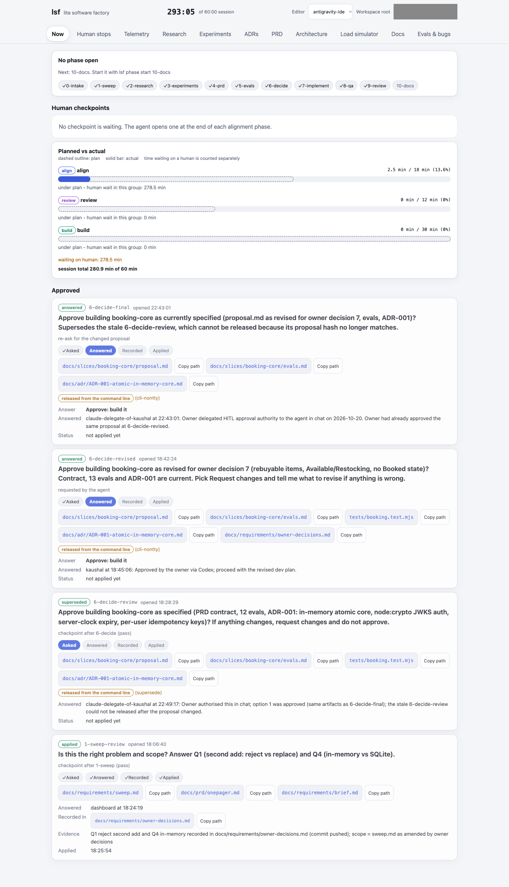

Shows "No phase open; Next: 10-docs" with the phase strip 0-intake to 10-docs (0 to 9 ticked; 10-docs not ticked), "No checkpoint is waiting", and a Planned vs actual bar chart by group (align 2.5 of 18 min; review 0 of 12 min and build 0 of 30 min, both drawn as empty bars). Human wait is about 278.5 min, so the session total reads 280.9 min of 60. Below that, under "Approved", the four stop cards (`6-decide-final` answered, `6-decide-revised` answered, `6-decide-review` superseded, `1-sweep-review` applied). Data comes from the phase and checkpoint records under `.factory` / `ops/events.jsonl`, with the plan from the build-loop profile.

## 02 Human stops
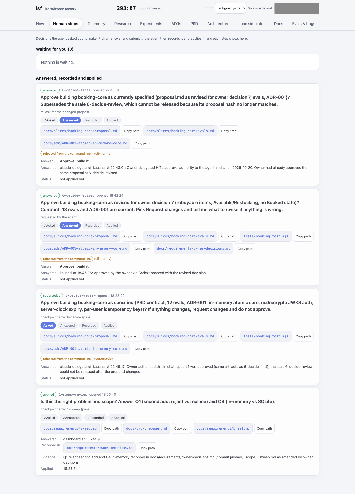

Reads "Waiting for you (0): Nothing is waiting", then four cards under "Answered, recorded and applied": `6-decide-final` (answered "Approve: build it" from the command line by `claude-delegate-of-kaushal`, with the note that the owner delegated approval to the agent and had already approved the same proposal at `6-decide-revised`; it says it supersedes the stale `6-decide-review`), `6-decide-revised` (answered by kaushal), `6-decide-review` (badge `superseded`, released from the command line via `supersede` at 22:49:17 with the note that the proposal hash no longer matched), and `1-sweep-review` (applied). The superseded card keeps its progress chips frozen at "Asked"; the answered cards stop at "Answered" and show "Status: not applied yet". There is no answer box or Approve button because nothing is open. Source is the hitl ledger (`.factory/stops` via `factory.hitl.store`) plus `ops/events.jsonl`.

## 03 Telemetry
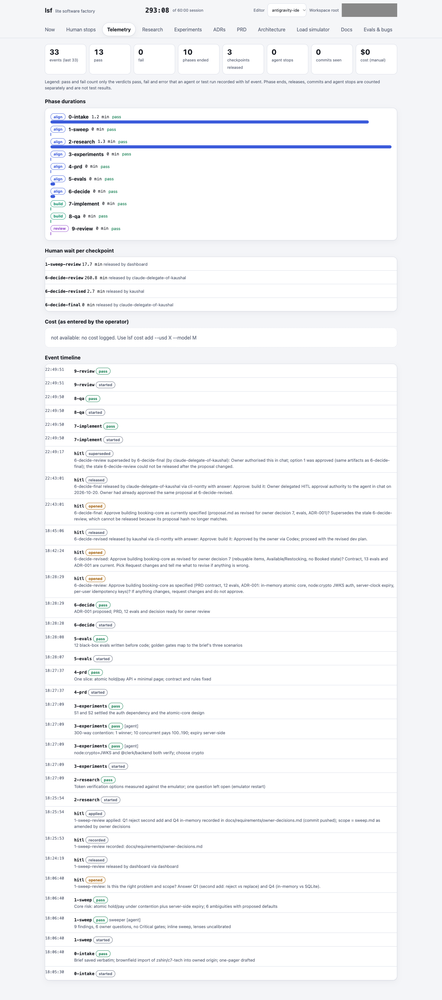

Shows counters for the last 33 events (13 pass, 0 fail, 10 phases ended, 3 checkpoints released, 0 agent stops, 0 commits seen, $0 manual cost), phase durations for 0-intake to 9-review (all pass; 0 to 1.3 min, 7-implement, 8-qa and 9-review each 0 min), human wait per checkpoint (`6-decide-review` 260.8 min, released by `claude-delegate-of-kaushal`), and an event timeline whose newest entries are 9-review, 8-qa and 7-implement pass/started and the `hitl superseded` event for `6-decide-review`. Cost reads "not available: no cost logged" (it would come from `lsf cost add`); events come from `ops/events.jsonl`. "0 commits seen" means no commit events were logged there; the Git tab shows the real history.

## 04 Research
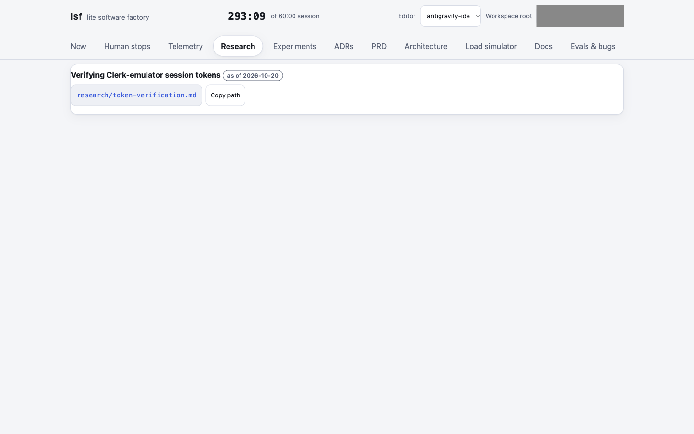

A single entry, "Verifying Clerk-emulator session tokens as of 2026-10-20", linking `research/token-verification.md`. The tab only lists the research note; it is not expanded in the page. Unchanged since the previous tour.

## 05 Experiments
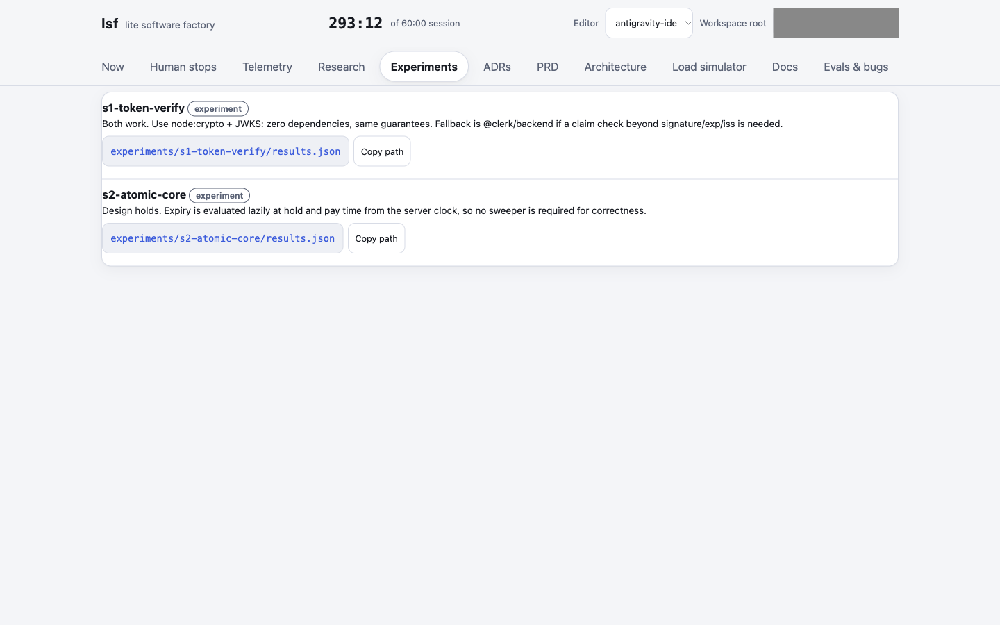

Two experiment cards, `s1-token-verify` (conclusion: use node:crypto + JWKS, with @clerk/backend as fallback) and `s2-atomic-core` (design holds; expiry is evaluated lazily from the server clock). Data is `experiments/<id>/results.json`. Unchanged since the previous tour.

## 06 ADRs
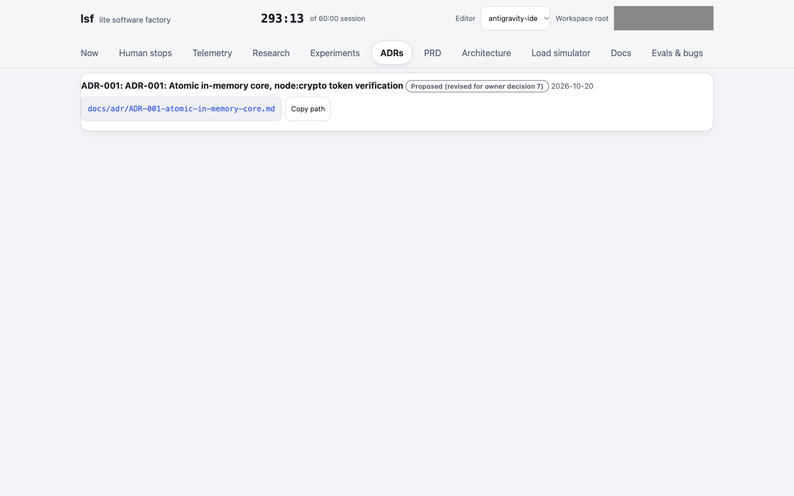

One ADR: ADR-001 "Atomic in-memory core, node:crypto token verification", status Proposed (revised for owner decision 7), dated 2026-10-20, from `docs/adr/ADR-001-atomic-in-memory-core.md`. Unchanged: the status still reads Proposed, not Accepted.

## 07 PRD
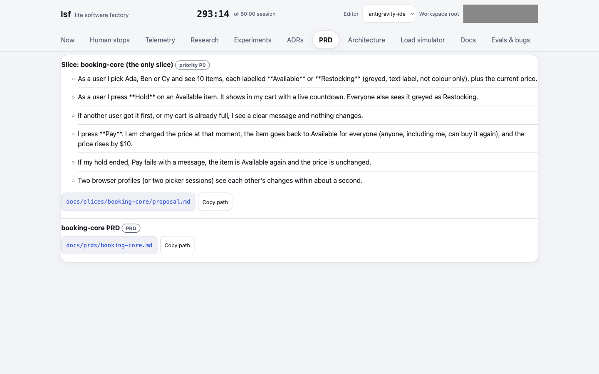

The slice `booking-core` (the only slice, priority P0) with its six user-journey steps (pick a user, Hold, conflict messages, Pay, expired hold, two-session sync) from `docs/slices/booking-core/proposal.md`, plus a link to the `booking-core PRD` at `docs/prds/booking-core.md`. Unchanged since the previous tour. No `docs/prd/onepager.md` `## Journey:` headings are rendered as separate journeys here.

## 08 Architecture (nested diagrams)
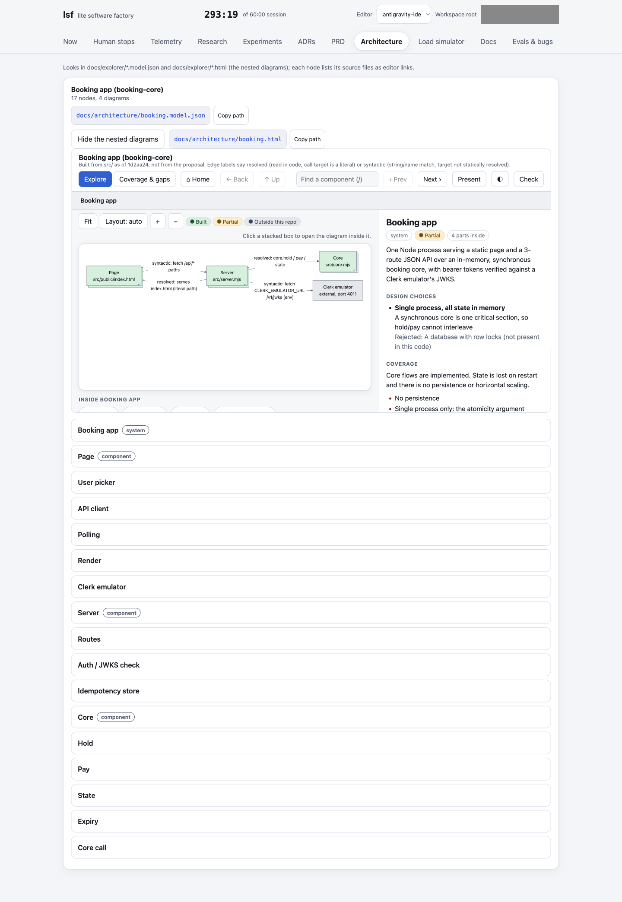

Shows the Architecture tab for `docs/architecture/booking.model.json` (17 nodes, 4 diagrams), with the embedded explorer `docs/architecture/booking.html` open at the top level: Page, Server, Core and the external Clerk emulator. Edge labels say `resolved` (read in the code, literal call target) or `syntactic` (string or env-var match; the page-to-server `/api/*` link and the Clerk JWKS fetch are syntactic). Colours are coverage: the system is Partial (no persistence, single process), Clerk is "Outside this repo". The model was written from `src/server.mjs`, `src/core.mjs` and `src/public/index.html` at 1d2aa24, not from the proposal; the tool's Check button reported 4 of 4 diagrams rendered, no problems. The model has not been compared against a running server. The model still says it is built from `src` at 1d2aa24; it was not regenerated after the later hardening commits (for example the JWKS refetch throttle), so its notes can lag the code.

Caveat: `lsf serve` refuses files over 1 MiB, and the normal self-contained build is 3.5 MB (Mermaid inlined). `booking.html` is therefore a slim build that loads Mermaid 11.17.2 from cdn.jsdelivr.net, so the diagrams need network access to render.

### 08b Level 2: Server
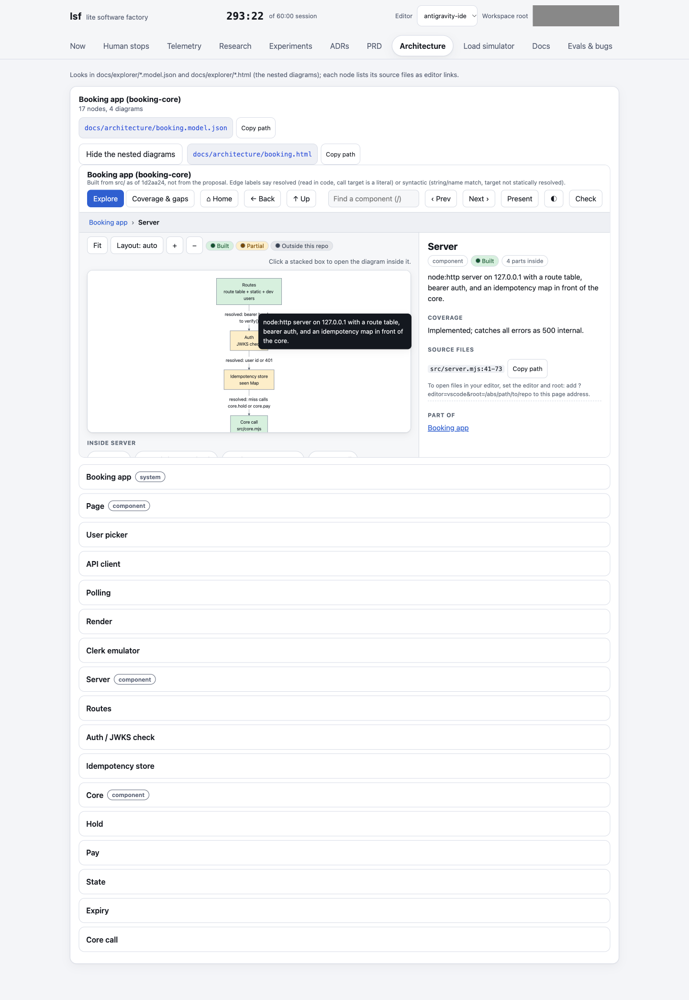

Clicking Server opens its diagram: Routes, Auth (JWKS check), Idempotency store and Core call, in request order, all edges `resolved`. Auth and the idempotency store are coloured Partial. The side panel lists `src/server.mjs:41-73`.

### 08c Level 3: Auth / JWKS check
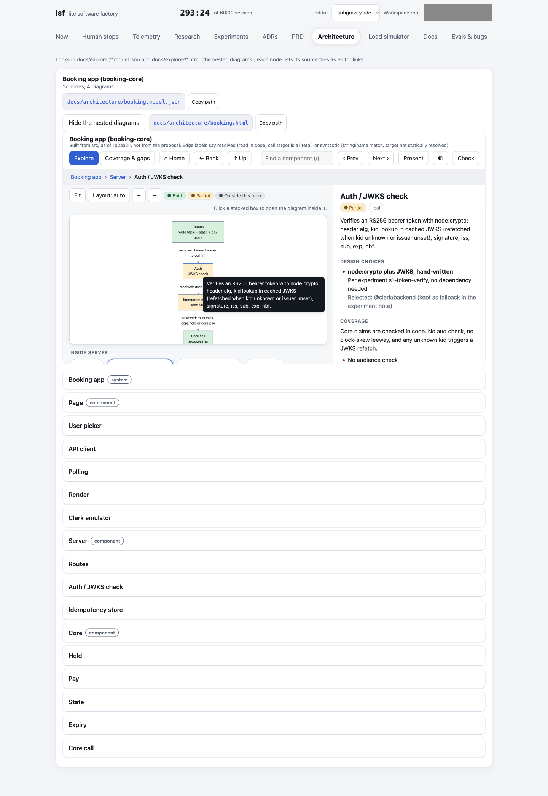

Clicking Auth / JWKS check selects the leaf: the panel describes RS256 verification with node:crypto (alg, kid, signature, iss, sub, exp, nbf) and lists the gaps found in the code: no audience check, no clock-skew leeway, and the panel says unknown-kid tokens each cause a refetch with no throttle (a later commit, `81c7a8b6`, added a 1s throttle, so this model note predates it). The panel also shows a hover tooltip over the node, left in the shot. Source files are `src/server.mjs` lines 14-17, 19-33 and 54-56 (checked by the model tool against the repo). The Core node opens the same way into Hold, Pay, State and Expiry, which is not screenshotted.

## 09 Load simulator
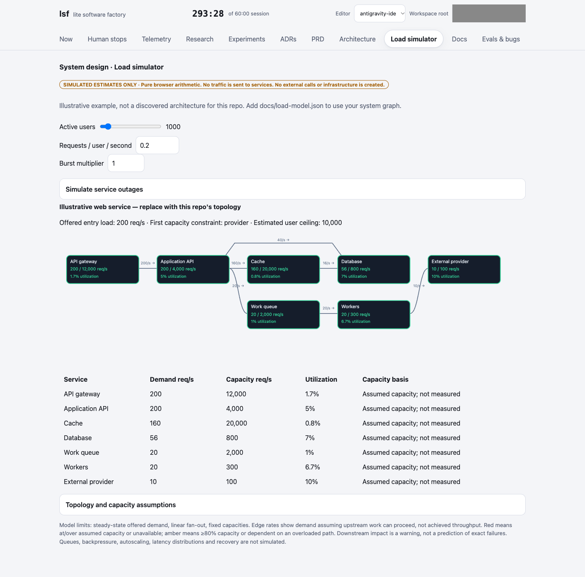

A browser-only system-design simulation labelled "SIMULATED ESTIMATES ONLY", with sliders for active users (1000), requests per user per second and burst multiplier, outage toggles, a 7-node topology graph, and a utilization table (e.g. database 56 of 800 req/s, 7%). It is an illustrative example, not this repo's architecture: the page says to add `docs/load-model.json` to use a real system graph, and all capacities are marked "Assumed capacity; not measured".

## 10 Docs
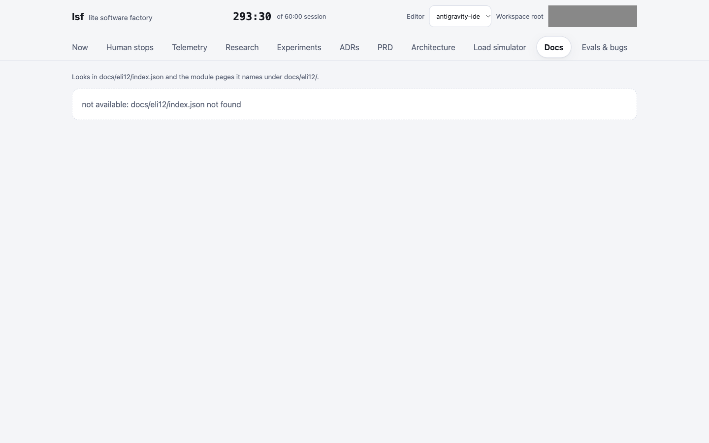

Still empty: "not available: docs/eli12/index.json not found". The tab reads `docs/eli12/index.json` and the module pages it names; none exist, and phase 10-docs has not started. Unchanged since the previous tour. The review, requirements-ledger and drift-check documents are not rendered by any tab.

## 11 Evals & bugs
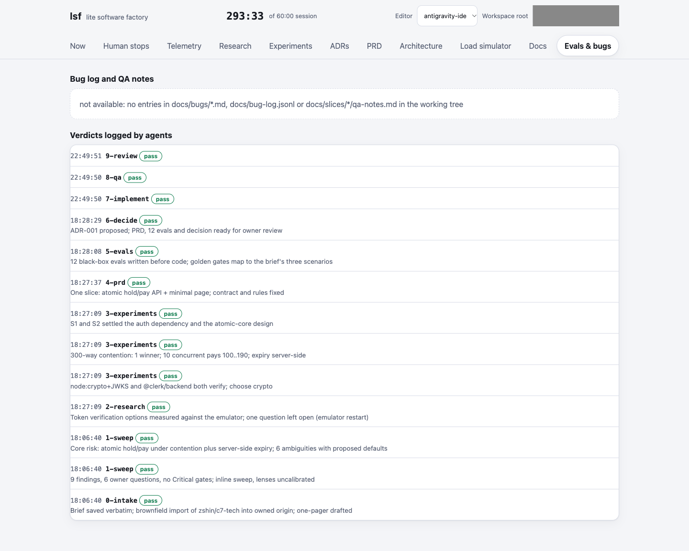

Bug log and QA notes still read "not available: no entries in docs/bugs/*.md, docs/bug-log.jsonl or docs/slices/*/qa-notes.md in the working tree". "Verdicts logged by agents" now lists thirteen pass verdicts, newest first: `9-review`, `8-qa` and `7-implement` (22:49:50-51, no detail text) followed by `6-decide` back to `0-intake` with their messages. They come from `lsf event` records in `ops/events.jsonl`. The dashboard does not show the 24 passing tests or a `GOLDEN.json` measurement.

## 12 Git
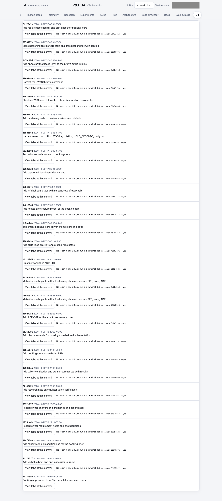

A commit list (newest `2bf23c1b Add requirements ledger and drift check for booking-core`, then hardening, review and tour commits) with timestamps, a "View tabs at this commit" link and a Rollback button per row. Data comes from the repository's git history.

## 13 Git: historical commit view
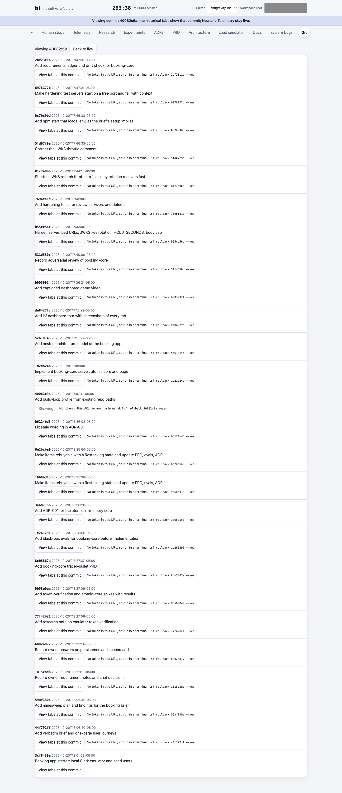

After choosing "View tabs at this commit" on `40082c9a`, a banner reads "Viewing commit 40082c9a: the historical tabs show that commit; Now and Telemetry stay live", the commit row says "Showing", and a "Back to live" button appears. Historical tabs are built from the git object database at that commit (see `ops-tabs.md`).
