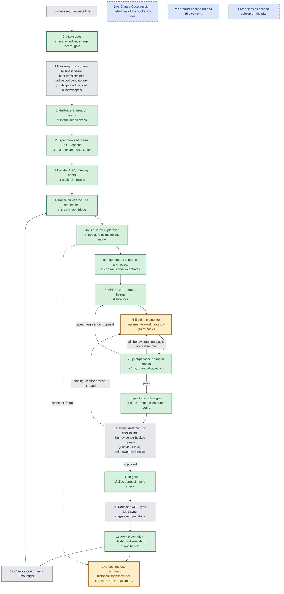

# The /sf flow as implemented (2026-10-19)

This document reconciles three things: the owner's authoritative workflow (`/home/linuxuser/sf-workflow-owner-request-verbatim.md`), the verification follow-up (`/home/linuxuser/sf-verification-followup.md`), and what the repository actually contains today. It is not aspirational: each node says what exists, what checks it, and what does not.

Evidence base (all run under `scripts/bounded-pytest.sh`, commit `agent-graph` head at time of writing): 4,551 unit tests pass; 1,498 agent-layer eval cases: 1,496 pass, 1 open (`TB06-D-035`, see `docs/adr/ADR-0004-blindness-guard-glob-through-symlinks.md`), 1 library self-check blocked by design; the golden gate is green, 141 of 141.

## Diagram

Legend: **green** implemented and tested; **yellow** implemented but not verified in its real environment; **grey** exists only as written procedure (no mechanical check); **blue dashed** planned, not built. A thick border marks a stage that is **new** in this build; thin-border stages existed before as prose and now have the commands named in the table.

Notes on the colours: `impl` is yellow because the guards are tested through the command line and simulated event streams but not inside a live Claude Code session (clarification C-34 is open), and `dash` because it was verified against this repository's history in a real browser but has not been deployed. `qa` is green for its logic (79 tests including a scripted fake implementer) but has not yet run against real agent sessions; that caveat is in the table. `review` is grey: the deterministic half is `sf slice done`, `sf contracts verify`, `sf structure diff` and the dolls check; the judgement half is written procedure.

## Stage table

| # | Stage | Inputs | Outputs | Tools, skills, hooks (actual names) | When it runs | Failure routing |
|---|---|---|---|---|---|---|
| 0 | Intake gate | A verbatim source brief | `docs/requirements/ledger.tsv` (one row per source line, trust column), `docs/requirements/sweeps/<source-sha>.json` | `spec-recomposition`, `minesweeper`, `sf intake check`, `record-sweep`, `signoff`, `gate` | At the start of a project and again when materially new external requirement text arrives (`gate --since SHA`) | No sweep record for the current source hash, an uncovered source line, an open Critical without sign-off or a High without a disposition: gate fails, dependent slices are blocked (`sf slice check --ledger`), the run continues with independent work |
| 1 | Research seeds | Ledger, lens list | `research/seeds.tsv`, `research/<topic>.md` with sources and "could not verify" | `biz-decomposer`, `grounded-research`, `deep-research`, `sf intake seeds check` | After the sweep; seeds fan out read-only | A completed seed without sources or output file fails the check; the seed is re-opened |
| 2 | Experiments | Open options not settled by research | `experiments/<id>/results.json` with a dated enumeration and a pre-registered rule | `experiment-designer`, `sf intake experiments check` | When two or more options remain | A literal candidate list, one metric, or no rule fails the check |
| 3 | Decide | Findings, experiment results | ADR in `docs/adr/` | `one-way-door`, `sf audit` (exit 3 when the verifier is unavailable), the `bash_guard` hook asks before force-push, destructive SQL, deploys | Per decision | Gate failure is not a safety verdict; fix the environment or record the decision as blocked |
| 4 | Slice | Ledger rows, ADRs | `docs/slices/<id>/` (UX stories first, criteria with IDs, tasks, priority, depends_on) | `prd-writer`, `docs/slice-format.md`, `sf slice check`, `triage` | Per slice, in dependency then priority order | `check` fails: the slice is not scheduled; a slice conditioned on an open Critical is blocked |
| 4b | Structure | Changed or entry symbols | Scoped scan, a dolls model, a symbol diff | `sf structure scan`, `scope`, `model`, `diff`; `mermaid-nesting-dolls` `check` and `build` | Before contracts and again after the change | Parse failures are reported, never dropped silently; `--strict` fails; unresolved edges are listed, never called resolved |
| 4c | Contracts | Slice criteria, structure | `contracts/*.yaml` with IDs, frame, assumptions | `contract-verify` skill, `sf contracts check-contracts` | After the slice, before code, authored by someone other than the implementer | Unsatisfiable or vacuous contracts fail (exit 17 or 18) before any code is written |
| 5 | Evals first | Contracts, criteria | Frozen cases; `criteria.lock` | `eval-designer`, `sf slice lock` | Before implementation | Criteria change only through an additive amendment or an explicit human or Codex approval marker |
| 6 | Blind implementation | Slice criteria, tasks, public contracts | Code, `[x]` on implemented tasks | `scripts/implementer-worktree.sh`; hooks `blindness_guard`, `path_guard`, `secrets_guard`, `bash_guard`, `stop_gate`, `subagent_stop`, `ledger_audit`, `session_start` (generated into project settings by `sf`'s emitter) | Each slice, one writer per worktree | A denied tool call returns a reason; the stop gate refuses "done" with skipped or weakened tests |
| 7 | QA | Code, protected suites | `qa-feedback/<n>.md`, `verified` ticks, regression proposals, attempt log | `qa-supervisor` skill, `sf qa`, `scripts/bounded-pytest.sh` | After each implementer pass | Retry same tier; escalate model tier at the policy point; same signature recurring proposes a regression case; at the cap hand to the reviewer; unresolved: mark blocked with what it waits on and move to the next independent slice. Environment crashes (disk, memory, timeout) never consume an attempt and keep the gate failed |
| 8 | Impact and solver gate | Base and head | JSON verification report, regression tests from counterexamples | `sf structure diff`, `sf contracts verify` | After QA passes | Exit 10 to 18 by cause; a missing solver, unrouted unsupported obligation, MODEL_MISMATCH, UNKNOWN or TIMEOUT all fail closed and are never "harmless" |
| 8b | Review | Diff, deterministic reports | Verdicts, amendments to the slice | `implementation-review`, Ponytail review rubric, minesweeper lenses, dolls; `sf slice amend --role reviewer` | After the gate | A finding becomes a triaged task or criterion (additive only) and re-opens implementer and QA; weakening needs an explicit approval marker |
| 9 | Drift gate | Verbatim source, slice, ledger | Pass or block | `sf slice done`, `sf intake check` | Before completion | An unverified task, broken chain, changed criterion or uncovered source line blocks completion |
| 10 | Docs and dashboard | Merged change | ADRs, docs, stage events | `doc-sync`, `scripts/ops-stage-event.sh STAGE SLICE VERDICT` at every stage boundary | Every stage, not only at the end | A stale document is recorded as known-stale rather than left silent |
| 11 | Commit and snapshot | Clean tree | Atomic commits; `ops/snapshots/<sha>/` | `sf ops bundle`, `sf ops runtime` | At every commit | Snapshots are reproducible from git (`--backfill`); runtime telemetry is separate and never part of a snapshot |
| 12 | Inbound | Task list, backlog, new text | Ranked ledger rows | `sf intake gate --since`, `progress-briefing` | End of every slice | "Nothing new" is stated explicitly |

## Native installation (how this flow runs inside Claude Code)

`sf install install --project DIR` writes the generated agents, the settings-level hooks (absolute, verified commands), the Sonnet-only pin and a manifest; `sf install doctor` executes the hook commands and fails if one cannot run, because a hook that cannot run fails open. The human stop (`sf hitl`) is checked at every stage start. Real headless sessions verified skill resolution, `/sf`, hook enforcement in subagents, a failing gate and its repair, a human stop and the Sonnet pin; the evidence and the stage-by-stage table are in `docs/native-verification/2026-10-19/REPORT.md`, and what that did not cover is listed there.

## What is new and what already existed

Existing before this build (prose or partial): the twelve stages, the minesweeper skill and its stage hooks, `one-way-door`, `doc-sync`, the ops-dashboard-design skill, the `sf audit/verify/run/transpile` commands.
Newly implemented and tested: the fail-closed governance gate; the intake ledger and gate; the slice format with role-checked ticks, hash-chained verification and a completion gate; structural scan and diff; contracts and the honest solver gate; the QA loop with a leak check; blind worktrees; the seven hooks, the roles, generator, emitter, ledger and walking skeleton; the dashboard bundle, runtime collector and shell; bounded test runs.

## Implemented but unverified

- The hooks in an interactive Claude Code session, and that a sub-agent's frontmatter `Stop` hook runs as `SubagentStop` (C-34). Headless real sessions did verify the PreToolUse denials, a failing gate and repair, and a human stop (`docs/native-verification/2026-10-19/REPORT.md`), so node 6 is amber only for the interactive case.
- The QA loop against real agent sessions (its simulation uses a scripted stand-in).
- The dashboard on a deployed host; per-product use.
- The adversarial acceptance of `factory/verify` and `factory/structure` by an independent tester is done; the report is `docs/acceptance/verify-structure-report.md` and its defects are fixed.

## Planned, not built

- A live rehearsal of the hooks in Claude Code (steps in `docs/hooks/e2e.md`).
- Applying the dashboard bundle to a product project and its separate deployment (deployment needs the owner's go).
- A code form of the minesweeper "core value and best practices" pass (today a documented procedure in `skills/intake-gate`).
- Languages other than Python in the structural scan; a real call graph from a compiler or LSP.
- Replacing Unity as the semantic verifier for the factory's own governance audit.
- A fresh-session second opinion on the plan.

## Honest limits

The Bash and blindness guards are command-text parsers and cannot be complete; accepted residual risk and the OS sandbox backstop are written in `docs/hooks/bash_guard.md`, `path_guard.md` and `blindness_guard.md`. The solver covers a small pure-Python subset and everything else must route to tests. Structure extraction is `ast`-based, Python only and never a complete call graph. Automated security review of the guards was run for several rounds; the remaining findings are of the same parser-bypass family and were recorded rather than chased.
